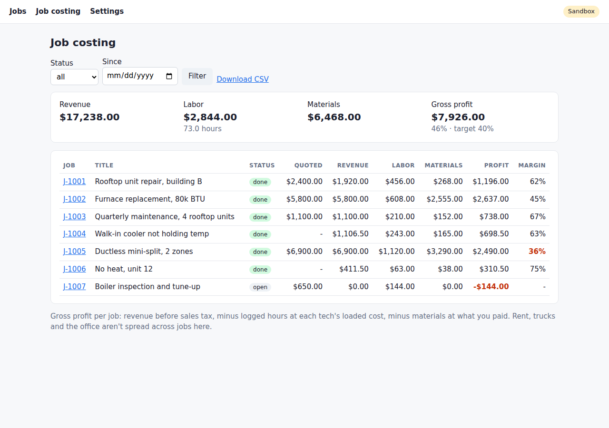

# QuickBooks Job Costing

See what every job actually made after labor and materials, and turn finished jobs into QuickBooks Online invoices without typing them twice. It's a free tool for service companies that sits next to QuickBooks, which stays your books, and it's made to be set up and reshaped with Claude Code in plain English.

It does three things QuickBooks makes hard for a service business:

1. **One record per job.** The customer, what you quoted, every tech's hours, the materials, and what you're billing, all in one place.
2. **Job to invoice, once.** When a job is done, it becomes a QuickBooks invoice with no re-typing. If you run it twice, you still get one invoice.
3. **Job costing.** What each job actually made after labor and materials, with the ones under your target margin in red.

QuickBooks stays your books. This tool can create invoices and customers in QuickBooks, and that's all it can write. It never edits, voids or deletes anything, and it never touches journal entries, bills, payments or payroll. That limit is in the code (`ALLOWED_WRITES` in `qbjobs/qbo.py`), not just in this README.



## Who it's for

Owners of service companies, roughly 5 to 50 people (HVAC, plumbing, electrical, and the like). You run QuickBooks Online, track jobs in spreadsheets or your head, and want to know which jobs make money before you spend $40K on an ERP in its first year.

It's a starting point, not a finished product. The idea is that you open it in Claude Code and have it reshaped to how your company works, for example: "add a job type and show me margin by type" or "import my jobs from this spreadsheet."

## What it costs

- **This repo:** free (MIT license).
- **Claude Code:** your own Claude plan. You pay Anthropic directly; nothing goes through me.
- **Intuit developer account:** free. It comes with a sandbox company, which is a practice QuickBooks company you can't hurt.

## Start here

You need a paid Claude plan (Pro is enough) and the Claude desktop app for Mac or Windows ([claude.com/download](https://claude.com/download)). No terminal needed.

1. Open the Claude app and click **Code** (not Chat or Cowork: Code is the part that can run programs on your computer).
2. Pick a new, empty folder for it.
3. Paste this:

```
Set up the free QuickBooks job costing tool from https://github.com/danwilsonai/quickbooks-job-costing in this folder. Read its CLAUDE.md first, then walk me through it.
```

Claude follows `.claude/skills/setup/SKILL.md` and walks you through it one step at a time:
- installing what it needs
- a made-up HVAC company to play with
- a Job Board icon on your desktop
- your free Intuit developer account
- connecting the sandbox, and your first test invoice

It asks before it runs anything, so read what it's about to do and say yes if it makes sense. On Windows, the Code tab needs [Git](https://git-scm.com/download/win) installed first.

**It runs on one computer.** Someone in the office enters hours from timesheets; it's not an app techs use from their phones. All your job data is one file, `jobs.db`, which setup can keep inside your Dropbox, OneDrive or Google Drive folder as a backup.

Prefer the terminal?

```bash
python3 -m venv .venv && .venv/bin/pip install -r requirements.txt
.venv/bin/python -m qbjobs demo        # a made-up HVAC company
.venv/bin/python -m qbjobs report      # job costing in the terminal
.venv/bin/python -m qbjobs serve       # the job board at http://localhost:5050
```

To connect QuickBooks, run `python -m qbjobs keys` and paste your Intuit app's keys into the file it opens, then run `python -m qbjobs connect`.

## Tested

Run end to end against an Intuit sandbox company on 2026-11-04:
- sign-in
- pulling items
- adding customers
- turning six finished jobs into invoices: one each, with the open job left alone
- resending a job, which created no duplicate
- losing the local link and resending, which re-linked the existing invoice
- repeating a request with the same request id, which returned the same invoice
- refusing a journal entry
- reading invoice totals back into the report, with the same numbers as the demo

The invoice number is the job number even with QuickBooks' custom transaction numbers setting off. Live books (production keys) were not part of this test.

## Before you point it at your real books

- **Start on the sandbox.** Run your own jobs through it for a week or two before switching `QBO_ENV` to `production`.
- **On live books:** every invoice needs a preview (`send --dry-run`) and an explicit `--confirm`. The job board shows LIVE BOOKS in red.
- **Your connection is a key to your books.** The sign-in file (`.qbo-tokens.json`) and your data (`jobs.db`) stay on your computer and are git-ignored. Back up `jobs.db` like any other business file.
- **Your numbers are yours.** Job costing is only as good as the loaded labor cost you enter for each tech (wage plus payroll taxes, workers' comp and benefits). Ask your bookkeeper if you're not sure.
- **Sales tax:** off by default, so QuickBooks uses each item's own taxable setting. Turn it on with `set sales_tax on` and mark taxable lines, then check a sandbox invoice with your bookkeeper.
- **Going live** needs production keys from Intuit. Intuit asks for links to a license agreement, a privacy policy and a few app pages, plus a short questionnaire. You can use the generic pages at [bedrockprocess.com/quickbooks-job-costing](https://bedrockprocess.com/quickbooks-job-costing/), and the setup walks you through it.
- **No warranty.** This is not accounting or tax advice. Have your accountant look at anything that changes how you invoice.

## How it's built

Plain Python, one SQLite file, and a small Flask page that only listens on your own computer. No cloud service, no account with me.

| Folder | What's there |
|---|---|
| `qbjobs/` | the code: database, QuickBooks connection, invoice sync, job costing, commands, web page |
| `templates/` | the job board pages |
| `.claude/skills/` | step-by-step instructions Claude Code follows: setup, customize, import-jobs |
| `CLAUDE.md` | the rules Claude Code works under in this repo |
| `tests/` | tests that use a fake QuickBooks, so they run without an account |

## Updating and removing it

- **Update:** `git pull` in the folder, then run the tests (`python -m pytest -q`). Your `jobs.db` and `.env` aren't touched, because they're never in the repo.
- **Remove:** run `python -m qbjobs disconnect` to delete the sign-in, then delete the folder (back up `jobs.db` first if you want your job history). To cut the connection on Intuit's side as well, delete the app in your Intuit developer account.

## License and help

MIT, see `LICENSE`. If you get stuck, open an issue.

## Who made this

[Bedrock Process](https://bedrockprocess.com) builds custom software and AI tools for owner-run companies. How this works, and when an ERP is and isn't worth it, is on [YouTube](https://www.youtube.com/@bedrockprocess). If you'd rather have it set up and shaped around your company for you, that's what we do.
